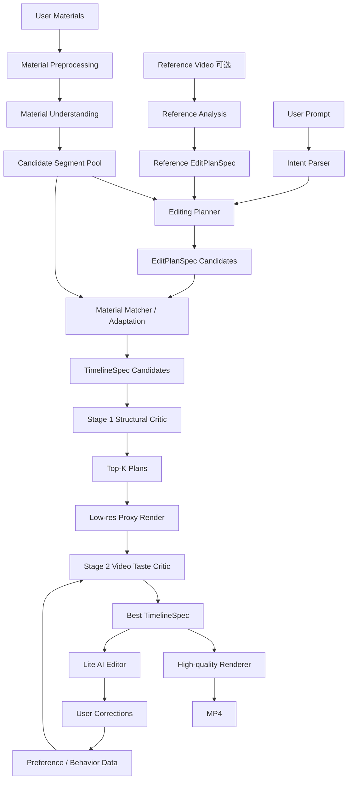
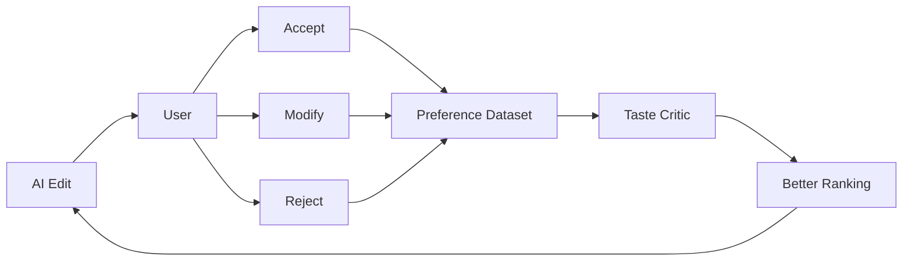

# AI 视频剪辑项目技术文档

**版本**：Technical Execution Draft · v1.1  
**阶段**：单人 MVP 开发 → 早期用户验证 → 后续组队  
**目标**：作为单人 MVP 的技术执行输入，与《AI 视频剪辑项目说明 v0.3》共同用于收敛最终 `TECHNICAL_PLAN.md`。先完成可真实演示、可被目标用户测试的 Lite MVP；验证核心产品与技术假设后，再据此招募合伙人和扩展团队。  
**核心定位**：不是“让用户更容易学会剪辑”，而是“让用户不需要学会剪辑，也能得到审美合格、可继续修改的视频”。

> **文档状态**：本文件取代此前的 `技术文档.md` 与 `技术文档_v0.2.md`，但不单独承担“最终真相源”。当前应与产品/路线层的《AI 视频剪辑项目说明 v0.3》一起交给 Coding Agent 做一次收敛，生成唯一执行基线 `TECHNICAL_PLAN.md`。


---

## 1. 项目目标

本项目面向两类用户，但 MVP 阶段只优先验证 Lite。

### Lite

目标用户是普通手机用户和轻量短视频创作者。

典型需求有两类，而且这两类都属于 **Lite 的一级核心功能**：

### Lite Core A — AI 自动成片

用户有很多素材，但不知道如何挑选、组织和剪成一个好看的 vlog。

```text
我的素材
+ 一句话需求
→ AI 自动挑片 / 排序 / 卡节奏 / 配音乐
→ 可直接发布的成片
```

### Lite Core B — 参考视频复刻（Reference Remake）

用户看到一条喜欢的博主视频，希望“我也要剪成这种感觉”，但不会分析节奏、镜头、转场、音乐、字幕、叙事结构等，也不想学习剪辑软件。

```text
我喜欢的参考视频
+
我的素材
→ AI 拆解参考视频的剪辑语言和审美结构
→ 将我的素材重新匹配到对应的镜头槽位
→ 生成“我的版本”
```

**参考视频复刻不是附加功能，而是 Lite 的一级核心产品入口和最强 Demo/获客入口之一；但“能参考视频剪”本身不是长期技术护城河。真正需要做深的是 Reference-to-Edit Grammar、Material Matching、Taste Critic、Preference Data 与可控可编辑的复刻质量。**

Lite 的理想体验不是“AI 帮我生成一个时间线，然后我自己继续剪”，而是：

> 上传素材，或者上传“参考视频 + 我的素材” → AI 直接给出尽可能可发布的成片 → 不满意时再做极简修改。

因此：

**AI First, Editor Second.**

编辑器是 AI 不稳定时的修正入口，而不是产品主流程。

### Pro

Pro 面向桌面端、长视频创作者、剪辑师和工作室。

目标不是完全替代专业剪辑，而是：

> 自动完成 60%–80% 的粗剪、素材筛选、节奏规划、字幕、B-roll、音乐与结构工作，再导出高分辨率视频或专业工程文件供用户继续精修。

Pro 在 MVP 阶段不实现，只要求底层数据结构不要把未来扩展到 Pro 的路堵死。

---

# 2. MVP 只验证四个核心假设

当前阶段不要试图构建“完整 AI NLE”。

MVP 只验证以下四个问题：

### H1：AI 能否从大量原始素材中挑出“值得用”的镜头？

也就是 Material Understanding + Shot Selection。

### H2：AI 能否把这些镜头组织成一个“明显比机械模板更好”的短视频？

也就是 Story Planning + Rhythm + Editing Taste。

### H3：Reference Remake 是否成立？

给定一条用户喜欢的参考视频，系统能否抽取其中可迁移的：

```text
结构
节奏
景别变化
镜头语义序列
转场密度
音乐关系
字幕风格
整体情绪
```

再把用户自己的素材重新映射进去，生成一个：

> **不是套模板，但明显“像这个参考视频的剪辑逻辑和感觉”的新视频。**

这是 Lite 的核心产品假设，不是附属研究功能。

### H4：加入 Preference / Taste Critic 后，用户是否明显更喜欢 AI 输出？

如果 H3/H4 不成立，就不应该急着做复杂编辑器、跨 NLE 导出或 RL。

---

# 3. MVP 范围

第一版必须主动缩小任务空间。

## 3.1 视频类型

只支持：

- Travel vlog
- Daily life vlog

暂时不支持：

- Talking head
- Podcast
- 游戏视频
- 专业广告
- Documentary
- 婚礼长片
- 复杂多机位
- 影视级叙事
- 大量特效型短视频

原因很简单：不同品类的“好剪辑”分布差异极大。

---

## 3.2 输入

### 模式 A：无参考视频

输入：

```text
20–100 条用户素材
+ 可选照片
+ 一句话 prompt
+ 可选背景音乐
```

示例：

```text
帮我剪一个 45 秒的东京旅行 vlog。
轻松、有氛围感，不要太多转场。
```

### 模式 B：参考视频复刻（Lite 核心）

输入：

```text
20–100 条用户素材
+ 一条 reference video
+ 可选文字约束
```

示例：

```text
按照这个视频的感觉帮我剪一个“我的版本”。
```

或者：

```text
复刻它的节奏和镜头结构，
但不要它的大字幕。
```

这里的 reference video 不只是“模仿视频”，而是：

> **Aesthetic Prompt + Editing Recipe Source**

MVP 的目标不是逐帧复制原视频，而是把参考视频拆成一个可迁移的 **Reference EditPlanSpec**：

```text
Reference Video
↓
结构层：开场 / 发展 / 高潮 / 结尾
↓
节奏层：shot duration / cut density / hold time
↓
镜头层：wide / medium / close-up / detail / POV 的排列
↓
语义层：环境 → 人 → 动作 → 细节 → 食物 → ending 等
↓
动效层：hard cut / zoom / speed / transition density
↓
音频层：beat sync / 音乐情绪 / 原声保留
↓
文字层：字幕密度 / 出现时机 / 风格
↓
Reference EditPlanSpec
```

然后将用户素材映射进去：

```text
Reference EditPlanSpec
+
User Material Segments
↓
Slot Matching
↓
Duration / Crop / Speed Adaptation
↓
My Version
```

用户感知到的不是“套了一个固定模板”，而是：

> **“AI 看懂了这条视频为什么这样剪，然后用我的素材重新剪了一版。”**

---

## 3.3 输出

MVP 输出两类结果：

### 默认输出

```text
MP4
```

用户应该可以直接播放、保存和发布。

### 可修改输出

内部保存两层表示：

```text
EditPlanSpec JSON   # 应该怎么剪：意图 / 故事 / slots / 节奏 / 文字 / 音频
TimelineSpec JSON   # 最终怎么执行：具体素材 / in-out / 时间位置 / speed / crop / transition
```

用户在 Lite 编辑器中做有限修改：

```text
换这个镜头
这段短一点
这段长一点
删除这段
换一个候选镜头
减少转场
换音乐
修改字幕
```

第一版不要实现专业 timeline UI。

---

# 4. 核心技术判断：不要学习“统一审美”

审美不是单一标量。

不同用户可能有完全相反的偏好：

```text
用户 A：
slow / cinematic / minimal / long shot

用户 B：
fast / energetic / beat-sync / short shot
```

两者都可能是好剪辑。

因此不要把系统定义成：

```text
Video → Universal Aesthetic Score
```

而应该定义为：

```text
Preference(Edit | Material, Prompt, Reference, User)
```

长期形式：

\[
R(E \mid M, P, R_f, U)
\]

其中：

- `E`：候选剪辑
- `M`：用户原始素材
- `P`：文字意图
- `R_f`：参考视频
- `U`：用户偏好表示

MVP 阶段先不建模 `U`，只做：

\[
R(E \mid M, P, R_f)
\]

也就是说：

> 不问“这个视频是否 universally 好看”，而问“对于这些素材和这个用户想要的风格，这是不是一个更好的剪辑”。

---

# 5. MVP 总体架构



MVP 的核心不是 Renderer。

真正需要自己优化的是：

```text
Material Understanding
Reference → EditPlanSpec
Material Matching / Adaptation
Editing Planner
Taste Critic
```

视频理解、ASR/OCR、模型推理和媒体处理可以大量复用现成能力。Renderer 在 MVP 里采用 **FFmpeg-first + Provider Interface**：先保证本地可控、便于 debug，后续可以替换为火山/其他云端渲染，不让业务逻辑绑定任何供应商。

---

# 6. 两层剪辑表示：EditPlanSpec + TimelineSpec

原先单一 `EditSpec` 同时承担“审美规划”和“最终时间线执行”，会导致 Reference Remake、语义级编辑和素材匹配互相耦合。MVP 正式拆成两层。

## 6.1 EditPlanSpec：描述“应该怎么剪”

它不绑定具体素材，是 Planner、Reference Analysis、Taste/Style 控制的主要表示。

```json
{
  "project_id": "demo_001",
  "intent": {
    "target_duration": 45.0,
    "aspect_ratio": "9:16",
    "style": ["travel", "relaxed", "minimal"],
    "user_constraints": ["少一点字幕"]
  },
  "story": {
    "sections": ["opening", "exploration", "food", "ending"]
  },
  "slots": [
    {
      "slot_id": "slot_01",
      "semantic_role": "opening_environment",
      "shot_type": "wide",
      "target_duration": 1.2,
      "motion": "slow_pan",
      "energy": 0.4
    },
    {
      "slot_id": "slot_02",
      "semantic_role": "person_activity",
      "shot_type": "medium",
      "target_duration": 0.8,
      "energy": 0.7
    }
  ],
  "rhythm": {
    "pace": "medium_fast",
    "transition_density": 0.15,
    "music_sync_strength": 0.7
  },
  "text": {
    "subtitle_density": "low",
    "style": "minimal"
  },
  "audio": {
    "mood": "warm",
    "keep_original_sound": true
  }
}
```

Reference 模式的核心输出就是 **Reference EditPlanSpec**。因此用户说：

```text
“只保留它的节奏” → 修改 / 锁定 EditPlanSpec.rhythm
“不要它的字幕”   → 修改 / 关闭 EditPlanSpec.text
“结构像它，但自由一点” → 保留 story，放松 slots / rhythm 约束
```

## 6.2 TimelineSpec：描述“最终具体怎么执行”

Material Matcher 把 `EditPlanSpec.slots[]` 与用户素材候选匹配，得到可执行时间线。

```json
{
  "project_id": "demo_001",
  "plan_id": "plan_004",
  "duration": 42.3,
  "tracks": [
    {
      "type": "video",
      "clips": [
        {
          "slot_id": "slot_01",
          "source_id": "clip_017",
          "source_in": 3.21,
          "source_out": 4.63,
          "timeline_start": 0.0,
          "timeline_end": 1.42,
          "speed": 1.0,
          "crop": null,
          "transition_out": "hard_cut"
        }
      ]
    }
  ],
  "audio": {
    "music_id": "music_01",
    "volume": 0.8
  }
}
```

数据流固定为：

```text
Prompt / Reference
      ↓
EditPlanSpec
      +
Material Segment Pool
      ↓
Material Matcher / Adaptation
      ↓
TimelineSpec
      ↓
RendererProvider
      ↓
MP4 / future NLE adapters
```

第一版两种 Spec 都要足够小，不提前设计一个 Premiere 替代格式；但 `intent / story / slots / rhythm / text / audio` 这几个语义层必须从第一天保留，因为它们是 Reference Remake、语义编辑和 preference learning 的挂载点。

---

# 7. Material Understanding

这一步决定 AI 能不能从几十条素材中“挑对东西”。

每一个视频先切成候选 segment。

推荐保存：

```json
{
  "segment_id": "clip17_seg03",
  "source_id": "clip17",
  "start": 3.2,
  "end": 6.7,

  "semantic": "close-up of ramen being served",
  "shot_type": "close_up",
  "camera_motion": "slow_pan_left",

  "people": 0,
  "face_quality": null,

  "technical_quality": 0.88,
  "composition_score": 0.79,
  "stability_score": 0.85,
  "motion_quality": 0.74,

  "emotion": ["warm", "cozy"],
  "interestingness": 0.82,

  "embedding": "..."
}
```

第一版不需要自己训练视觉模型。

可组合：

```text
shot boundary detection
+
Video/VLM description
+
image/video embedding
+
简单 CV quality metric
```

目标不是生成完美标签，而是得到足够好的候选池。

---

# 8. Reference Analysis

Reference Video 的任务不是恢复所有原始剪辑参数。

MVP 只需要抽取“可迁移的 editing grammar”，并编译成 `Reference EditPlanSpec`。

例如：

```json
{
  "duration": 37.8,

  "shot_duration_stats": {
    "mean": 1.15,
    "median": 0.93
  },

  "shot_pattern": [
    "wide",
    "detail",
    "medium",
    "close_up",
    "wide"
  ],

  "pace": "fast",

  "transition_density": 0.08,

  "music": {
    "beat_sync_strength": 0.82
  },

  "semantic_structure": [
    "opening_environment",
    "person_activity",
    "detail",
    "food",
    "ending_environment"
  ],

  "style_tags": [
    "travel",
    "clean",
    "energetic",
    "minimal_transition"
  ]
}
```

重要的是：

> 不追求 pixel-level 复刻，而追求 transferable style。

---

# 8.1 Reference Remake Pipeline（Lite 核心链路）

复刻功能必须单独看成一条完整 pipeline，而不是“Reference Analysis 的一个输入选项”。

## Step 1：Reference Decomposition

把参考视频解析成结构化剪辑配方：

```text
Reference Video
↓
Shot Boundary
↓
Shot Semantics
↓
Shot Scale / Camera Motion
↓
Duration / Rhythm
↓
Music Beat / Cut Alignment
↓
Transition / Speed Pattern
↓
Subtitle / Text Pattern
↓
Narrative / Emotional Structure
↓
Reference EditPlanSpec
```

## Step 2：构建 Reference Slots

例如参考视频得到：

```json
[
  {
    "slot": 1,
    "role": "opening_environment",
    "shot_type": "wide",
    "duration": 1.2,
    "motion": "slow_pan",
    "energy": 0.4
  },
  {
    "slot": 2,
    "role": "person_activity",
    "shot_type": "medium",
    "duration": 0.8,
    "motion": "handheld",
    "energy": 0.7
  },
  {
    "slot": 3,
    "role": "detail",
    "shot_type": "close_up",
    "duration": 0.55,
    "energy": 0.8
  }
]
```

## Step 3：User Material → Candidate Pool

用户素材同样被切成 segment，并提取：

```text
semantic
shot type
camera motion
quality
emotion
duration
people / object
interesting moment
```

## Step 4：Slot Matching

为每个 reference slot 在用户素材中寻找候选：

\[
S(i,j)=
w_s S_{semantic}
+w_v S_{visual}
+w_m S_{motion}
+w_q S_{quality}
+w_e S_{emotion}
\]

其中：

- `i`：reference slot
- `j`：user segment

MVP 不需要复杂学习型 matcher，可以先：

```text
embedding retrieval
+
规则过滤
+
LLM/VLM rerank
```

## Step 5：Adaptation

参考视频和用户素材永远不会完全一一对应，所以必须允许适配：

```text
Trim
Speed
Crop
Reframe
Skip Slot
Merge Slot
Replace Semantic Role
Extend / Shorten
```

这一步非常关键。

产品不能要求：

> “你没有和博主一模一样的镜头，所以无法复刻。”

而应该做到：

> “尽可能复刻它的剪辑逻辑；素材不匹配时，用最合理的替代方案保持节奏和叙事。”

## Step 6：生成多个 Remake Candidates

```text
Reference EditPlanSpec
+
Matched User Segments
↓
Candidate A
Candidate B
Candidate C
Candidate D
```

不要只生成一个版本。

## Step 7：Reference-aware Taste Critic

Critic 不只判断“好不好看”，还判断：

```text
Editing Quality
+
Reference Similarity
+
User Intent
```

因此复刻模式的 reward 应写成：

\[
R(E \mid M,P,R_f)
=
\lambda_a R_{aesthetic}
+
\lambda_r R_{reference}
+
\lambda_i R_{intent}
+
\lambda_t R_{technical}
\]

其中 `R_reference` 不是像素相似度，而是：

```text
structure similarity
rhythm similarity
shot-pattern similarity
semantic-role similarity
music-edit relationship
transition density
text/style similarity
```

## Step 8：输出 My Version

最终 UI 应该非常简单：

```text
参考视频
+
我的素材
↓
AI 分析中
↓
“你的版本已生成”
```

然后提供：

```text
直接保存
重新生成
更像参考
自由一点
只保留它的节奏
只保留它的结构
进入简易编辑
```

这些控制项以后可以映射到 Reference EditPlanSpec 的不同层。

---

# 9. Editing Planner

Planner 的输入：

```text
Material Candidates
+
Prompt
+
Reference EditPlanSpec
```

输出：

```text
EditPlanSpec
```

MVP 不需要训练专用 Planner。

可以先用强 LLM/VLM 做规划。

但不要直接让 LLM 输出“最终视频”。

让它先输出结构化 `EditPlanSpec`；具体素材绑定由 Material Matcher 完成，再生成 `TimelineSpec`。

例如：

```text
Slot 1:
semantic = opening wide shot
duration = 1.4 s

Slot 2:
semantic = person entering scene
duration = 0.8 s

Slot 3:
semantic = detail
duration = 0.6 s
```

再从候选素材中检索匹配片段。

推荐做成两阶段：

```text
Story / Rhythm Planning
        ↓
Slot Definition
        ↓
Material Retrieval / Slot Matching
        ↓
TimelineSpec Assembly
```

这样比直接让模型从 80 条素材里一次选完整 timeline 更容易 debug。

---

# 10. Taste Critic：MVP 的核心模型

Taste Critic 是第一阶段真正值得训练的模型。

它不负责生成。

它负责回答：

> 对于同一批素材和同一个用户目标，Edit A 和 Edit B 哪个更好？

形式：

\[
P(E_A > E_B \mid M,P,R_f)
\]

第一版甚至可以做 pairwise classification，而不是 scalar reward。

输入：

```text
Raw Material Summary
Prompt
Reference Summary / EditPlanSpec
Candidate A (EditPlanSpec or low-res render)
Candidate B (EditPlanSpec or low-res render)
```

输出：

```text
A better
B better
Tie
```

辅助输出：

```text
shot selection
rhythm
story
music matching
transition
overall aesthetics
```

---

# 11. 为什么先做 Critic，而不是直接 RL

当前阶段不要从 RLHF / GRPO 开始。

路线应该是：

```text
Human Preference Data
        ↓
Preference / Taste Critic
        ↓
Best-of-N
        ↓
DPO
        ↓
RL（必要时）
```

第一阶段目标只是验证：

> 一个经过 preference fine-tuning 的 Critic，能不能比基础 VLM 更接近人类审美判断。

如果不能，就说明问题在数据、任务定义或者表示上，而不是 RL 算法不够高级。

---

# 12. Human Preference 数据设计

## 12.1 标注对象

不是：

```text
哪个视频更漂亮？
```

而是：

```text
给定原始素材 + 用户要求 + 可选 reference，
A 和 B 哪个剪得更好？
```

---

## 12.2 第一版需要多少人

建议：

```text
8–12 个核心标注者
```

构成：

```text
4–6 个懂剪辑的人
+
4–6 个普通目标用户
```

专业用户与普通用户的标签不要完全混在一起。

保存：

```text
expert_preference
consumer_preference
```

因为：

```text
专业剪辑质量
≠
普通用户愿不愿意发
```

---

## 12.3 第一版数据量

目标：

```text
500–1000 preference pairs
```

其中：

```text
约 70%：
单标注者

约 20%：
3 人重复标注
用于 inter-rater agreement

约 10%：
3–5 人标注
作为 held-out evaluation
```

不要把所有样本都做 5 人投票，成本太高。

---

## 12.4 Preference UI

主问题：

```text
Which edit is better?

A
B
Tie
```

第二层：

```text
Why?

shot selection
rhythm
storytelling
music matching
transition
overall aesthetics
```

Lite 用户还应回答：

```text
Would you post this?

Yes
Maybe after editing
No
```

这个问题未来可能成为真正产品 KPI。

---

# 13. 审美不一致怎么处理

这是本项目必须从第一天就保留的信息。

假设：

```text
A vs B
```

五个人结果：

```text
A
A
B
B
B
```

不要只保存：

```text
B = GT
```

应该保存：

```json
{
  "A_votes": 2,
  "B_votes": 3,
  "tie_votes": 0
}
```

并保存 annotator metadata：

```text
expert / consumer
style preference
age range
content usage frequency
```

注意隐私，只保存真正需要的非敏感信息。

长期可以建立：

```text
Taste Cluster 1:
cinematic / slow / minimal

Taste Cluster 2:
fast / energetic / beat-driven
```

最终发展成：

\[
P(A>B\mid U)
\]

也就是 Personalized Taste。

MVP 不需要实现个性化，但数据结构必须保留 disagreement，不能把它清洗掉。

训练时不要机械地把 3:2 多数票变成硬标签 `B=1`。至少在评测和后续模型阶段保留 vote distribution，例如：

\[
P(B>A)=0.6,\quad P(A>B)=0.4
\]

并分别统计：

```text
expert preference distribution
consumer preference distribution
```

如果两类人稳定出现相反选择，这不是“脏数据”，而可能代表真实的 taste cluster。

---

# 14. Synthetic Preference Data

第一版不可能全部依赖人工剪辑。

可以从一个“较好 timeline”自动制造坏版本：

### Bad Rhythm

随机改变 shot duration。

### Bad Ordering

打乱局部顺序。

### Bad Shot Selection

换成语义类似但质量更差的候选镜头。

### Repetition

连续插入相似镜头。

### Music Misalignment

把 cut point 整体偏移。

### Over-editing

人为增加大量 transition。

### Under-editing

所有镜头长度固定。

得到：

```text
Good Edit > Corrupted Edit
```

这类数据适合 bootstrap。

但最终仍需要真实的人类 A/B 数据，否则 Critic 很可能只学会识别“人工破坏”。

---

# 15. Best-of-N：分层筛选，而不是 N 次高清渲染

不要一开始追求 Planner 一次生成完美结果，也不要把 4–8 个候选全部做高质量渲染。

MVP 采用三级策略：

```text
Planner
↓
生成 4–8 个 EditPlanSpec / TimelineSpec candidates
↓
Stage 1：Structural Critic（不渲染）
- story / slot coverage
- shot diversity
- duration / rhythm
- semantic match
- reference structure similarity
↓
保留 Top 2–3
↓
Stage 2：360p / 540p Low-res Proxy Render
↓
Video Taste Critic
- aesthetic quality
- rhythm in actual playback
- music-image harmony
- reference/style match
↓
选择 Top-1
↓
Stage 3：1080p / 4K High-quality Final Render
```

即：

```text
8 plans → 3 cheap previews → 1 HQ render
```

而不是：

```text
8 plans → 8 HQ renders
```

这样同时解决三个问题：

```text
验证 Critic 是否有效
控制推理 / 渲染成本
降低用户等待时间
```

MVP 的关键实验仍然是：

```text
Baseline：Planner single output
vs.
Planner + hierarchical Best-of-N + Taste Critic
```

做 blind preference test；如果后者显著更好，核心技术假设成立。

---

# 16. 推荐的技术栈

第一版以“快”为第一优先级。

## Backend

```text
Python
FastAPI
Pydantic
PostgreSQL 或 SQLite
Redis 可选
```

## Video / Rendering

```text
FFmpeg        # MVP 默认 renderer
OpenCV        # 轻量 CV / quality / frame analysis
PyAV 可选
```

MVP 先使用 FFmpeg 是为了本地可控、低成本和便于 debug，不代表要自研媒体引擎。所有渲染必须通过 `RendererProvider`：

```python
class RendererProvider:
    def render(self, timeline_spec, quality="proxy"):
        ...

class FFmpegRenderer(RendererProvider):
    ...

# 后续
class VolcengineRenderer(RendererProvider):
    ...
```

## AI

第一版优先调用现成：

```text
Video/VLM API
LLM API
Embedding Model
ASR API
```

可以接：

```text
阿里百炼
火山引擎
其他兼容模型 API
```

业务代码必须做 provider abstraction：

```python
class VideoUnderstandingProvider:
    ...

class LLMProvider:
    ...

class RendererProvider:
    ...
```

不要让业务层直接写死某一家 API。

---

## Frontend

Lite MVP：

```text
Next.js / React
```

先做 Web Demo。

不要第一天就开发 iOS / Android。

Web 足以验证：

```text
upload
processing
preview
A/B test
simple edit
export
```

如果 Lite 验证成功，再做手机 App。

---

# 17. 推荐 Repo 结构

```text
ai-video-editor/
│
├── apps/
│   ├── web/
│   └── api/
│
├── packages/
│   ├── edit_plan_spec/
│   ├── timeline_spec/
│   ├── compiler/
│   ├── providers/
│   ├── planner/
│   ├── critic/
│   ├── material_understanding/
│   ├── reference_analysis/
│   └── renderer/
│
├── pipelines/
│   ├── preprocess.py
│   ├── analyze_material.py
│   ├── analyze_reference.py
│   ├── generate_candidates.py
│   ├── rank_candidates.py
│   └── render.py
│
├── data/
│   ├── raw/
│   ├── processed/
│   ├── preferences/
│   └── eval/
│
├── experiments/
│   ├── critic_baseline/
│   ├── best_of_n/
│   └── preference_ft/
│
├── scripts/
│   ├── generate_corruptions.py
│   ├── build_preference_pairs.py
│   └── evaluate_critic.py
│
└── docs/
    ├── architecture.md
    ├── edit_plan_spec.md
    ├── timeline_spec.md
    ├── annotation_guideline.md
    └── evaluation.md
```

---

# 18. 数据库核心表

至少需要：

```text
projects
assets
segments
references
edit_plan_specs
timeline_specs
renders
preference_pairs
preference_votes
users
```

Preference 数据一定要从第一版就结构化保存。

例如：

```json
{
  "pair_id": "pair_001",
  "project_id": "p_123",

  "edit_a": "edit_04",
  "edit_b": "edit_07",

  "reference_id": "ref_03",

  "annotator_id": "anon_017",
  "annotator_type": "expert",

  "choice": "A",

  "reasons": [
    "rhythm",
    "shot_selection"
  ]
}
```

---

# 19. MVP 开发路线

## M0：先证明 pipeline 能跑

时间目标：

```text
1–2 周
```

完成：

```text
上传 20–50 条素材
↓
自动切 segment
↓
VLM 描述
↓
LLM 生成最小 EditPlanSpec
↓
Material Matcher 生成 TimelineSpec
↓
FFmpeg 渲染 MP4
```

此阶段：

```text
没有 Critic
没有参考视频
没有编辑器
```

目标只有一个：

> end-to-end 跑起来。

---

## M1：Auto Edit Baseline（把 Mode A 做到能看）

时间目标：

```text
1–2 周
```

加入：

```text
候选镜头 quality
semantic retrieval
story planning
音乐 beat
简单节奏
```

目标：

> 同一批素材，输出开始像一个“有人剪过”的 vlog，而不是随机拼接。

---

## M2：Reference Remake（Lite 第二核心功能）

时间目标：

```text
2–3 周
```

M2 不是简单“加入一个 reference 输入”，而是要完整跑通：

```text
Reference Video
↓
Reference Decomposition
↓
Reference EditPlanSpec
↓
Reference Slots
        +
User Materials
↓
Material Segments
↓
Slot Matching
↓
Adaptation
↓
Generate 3–4 Remake Candidates
↓
Reference-aware Ranking
↓
My Version
```

第一版优先复刻：

```text
1. 整体结构
2. shot duration / rhythm
3. shot-type pattern
4. semantic role sequence
5. transition density
6. music-cut relation
7. subtitle density
```

第一版明确不追求：

```text
pixel-level 复制
复杂特效完全还原
复杂 mask
精确调色 LUT 逆向
复杂 motion graphics
```

M2 必须能做出最核心的产品 Demo：

```text
左：我喜欢的博主视频
中：我的 30–50 条素材
右：AI Remake — My Version
```

并让测试用户回答两个问题：

```text
1. 像不像我给的参考视频？
2. 即使不看参考，这个视频本身好不好看 / 愿不愿意发？
```

这两个指标必须分开记录。

---

## M3：Preference Dataset + Taste Critic v0

时间目标：

```text
2–4 周
```

先收集：

```text
500–1000 pairs
```

比较：

```text
Random
Base VLM
Prompted VLM
Fine-tuned Critic
```

主要指标：

```text
Pairwise Preference Agreement
Soft vote-distribution calibration
Expert Agreement
Consumer Agreement
```

---

## M4：Best-of-N

Planner 一次生成：

```text
4–8 candidates
```

执行分层 ranking：Structural Critic（不渲染）→ Top-K 低清 proxy → Video Taste Critic → Top-1 HQ。

做正式 blind test：

```text
Single generation
vs
Best-of-N
```

如果 preference win rate 明显上升，就证明核心路线成立。

---

## M5：Lite Editor + Closed Beta

只做：

```text
替换镜头
删除
长一点
短一点
换音乐
改字幕
重新生成这一段
```

此时开始采集：

```text
user corrections
direct export / reject / regenerate
```

用户修改本身就是 preference data。M5 同时邀请真实目标用户做 closed beta，记录 Direct Export Rate、Remake Satisfaction、修改次数和 Time to Good Video。

---

## M6+：Pro Prototype（MVP 之后）

只有 Lite 的核心假设得到正向信号后，再开始：

```text
long-form rough cut
OTIO / XML adapters
high-resolution export
professional workflow evaluation
```

---

# 20. MVP 成功指标

不要只看模型离线指标。

真正产品指标至少包括：

### AI Edit Acceptance Rate

```text
用户是否接受 AI 输出
```

### Direct Post / Export Rate

```text
用户是否愿意直接导出
```

### Edit Distance After AI

```text
用户还修改了多少
```

修改越少，默认剪辑越成功。

### Pairwise Preference Win Rate

```text
Our System
vs
Baseline
```

### Reference Remake Similarity

复刻模式必须单独评估：

```text
结构像不像
节奏像不像
镜头模式像不像
整体“感觉”像不像
```

这里优先使用人类 pairwise / rating，而不是像素指标。

### Remake Satisfaction

最直接的问题：

```text
“如果你就是因为喜欢这条参考视频才来使用产品，
这个结果满足你的预期吗？”
```

可以记录：

```text
Yes
Partially
No
```

### Time to Good Video

```text
从上传素材
到用户满意
用了多久
```

这个指标非常重要。

因为产品的核心就是：

> 减少普通人从素材到“好视频”的成本。

---

# 21. 不要在 MVP 阶段做的东西

以下东西全部后置：

```text
完整专业 timeline editor
Premiere XML
DaVinci 工程
剪映草稿完整兼容
复杂 mask
复杂 compositing
复杂关键帧
精确滤镜逆向
自研 renderer
自己训练大型 Video Foundation Model
RL / GRPO
个人 taste embedding
原生 iOS / Android
多人协作
完整素材管理 DAM
```

任何一个都可能让项目提前失控。

---

# 22. 第一个真正该做的 Experiment

如果只能选一个 AI 实验，不是训练 Planner。

而是：

> **Taste Critic 是否能学会“剪辑偏好”。**

准备：

```text
20–30 组 travel / daily vlog 素材
```

每组：

```text
1 个较好版本
+
3–5 个 AI / corrupted versions
```

形成：

```text
100–300 个初始 pair
```

先不用微调。

拿现有 Video-VLM 做：

```text
zero-shot pairwise judging
```

测：

```text
与专业剪辑者 preference 的一致率
```

然后再：

```text
LoRA / preference fine-tuning
```

看是否明显提高。

如果：

```text
Base VLM      55–60%
Fine-tuned    75–80%
```

这就是非常强的 MVP research result。

---

# 23. 后续训练路线

只有在 M3/M4 验证成功后才进入：

```text
Preference Data
↓
Taste Critic
↓
Best-of-N
↓
更多真实用户数据
↓
DPO Planner
↓
Personalized Preference
↓
必要时 RL / GRPO
```

不是：

```text
先训练一个巨型 Agent
↓
然后希望它有审美
```

---

# 24. 数据飞轮

产品上线后最有价值的数据不是公开视频。

而是：

```text
AI 给出 Edit A
↓
用户接受
```

这是 positive signal。

或者：

```text
AI 给出 Edit A
↓
用户删除 shot 7
```

这是 shot-selection negative signal。

或者：

```text
1.8 sec
↓
用户改成
0.7 sec
```

这是 rhythm correction。

或者：

```text
系统给 A/B/C
↓
用户选择 B
```

这是天然 preference pair。

最终：



这个数据闭环比单纯爬大量 TikTok 更有长期价值。

---

# 25. 后期招人的顺序

在 MVP 之前不需要完整团队。

当 M2/M3 跑起来后，优先寻找：

### 第一优先：强产品 / Full-stack 工程

能够把：

```text
AI pipeline
+
backend
+
frontend
+
video infra
```

真正做成产品。

### 第二优先：懂剪辑 / creator

不是只来“评价结果”。

需要参与：

```text
annotation rubric
editing grammar
failure taxonomy
preference evaluation
```

### 第三优先：Video / Multimodal ML

当 Preference Critic 已经证明有价值后，再扩大模型侧工作：

```text
fine-tuning
multimodal reward
planner training
personalization
```

### 后期才需要

```text
NLE / media infrastructure expert
mobile engineer
growth
design
```

---

# 26. 单人阶段的工作原则

现在最危险的事情是把自己变成：

```text
视频播放器工程师
+
FFmpeg 工程师
+
Agent framework 工程师
+
前端工程师
+
模型训练工程师
```

结果半年以后仍然没有用户可以试。

单人阶段应该遵守：

```text
凡是用户感知不到的基础设施：
优先买 / 调 API / 用开源。

凡是决定“剪得好不好”的能力：
自己掌握数据、评测和核心逻辑。
```

真正需要积累的资产是：

```text
EditPlanSpec + TimelineSpec
Preference Dataset
Editing Evaluation
Taste Critic
User Correction Data
```

而不是：

```text
自己实现了一个 ASR
自己实现了一个转码器
自己写了一个 Agent SDK
```

---

# 27. 未来技术护城河

如果产品成立，真正的 moat 可能来自四层：

```text
1. Editing Preference Dataset

2. Conditional / Personalized Taste Model

3. Reference → Editing Grammar

4. 用户修改形成的数据飞轮
```

最终理想状态：

```text
“剪得好”
+
“像你想要的”
+
“越来越像你的审美”
```

而不是单纯：

```text
AI 会调用剪辑工具。
```

---

# 28. 从今天开始具体做什么

建议严格按这个顺序：

```text
Day 1–2
搭 repo、上传、FFmpeg pipeline、EditPlanSpec / TimelineSpec schema。

Day 3–5
做素材切分 + VLM description + segment database。

Day 6–8
做最简单 Planner：
从候选 segment → JSON timeline。

Day 9–10
完成 renderer：
TimelineSpec → RendererProvider → MP4。

Day 11–14
开始改 shot selection / rhythm，
做第一个“能看”的 travel vlog。

Week 3
加入 Reference Analysis。

Week 4
做 preference annotation 页面，
开始收第一批 A/B 数据。

Week 5–6
Taste Critic baseline + fine-tuning。

Week 7
Best-of-N。

Week 8
找真实普通用户做 blind test。
```

到这里，如果能够证明：

```text
Reference + Material
→
AI 可以稳定给出有审美的短视频

并且

Taste Critic
明显提高人类 preference win rate
```

就已经足够拿着 MVP 去找技术合伙人、剪辑领域的人以及早期用户。

---

# 29. MVP 最终 Demo 应该长什么样

不要展示后台。

Demo 只需要：

```text
Step 1
上传我手机里的 40 个旅行视频

Step 2
选择：
“自动帮我剪”
或
“像这个视频一样剪”

Step 3
等待

Step 4
直接播放一个 30–60 秒成片

Step 5
不喜欢某一段：
点它
→ 换一个镜头 / 短一点 / 重做

Step 6
Export
```

用户完全不需要理解：

```text
Agent
VLM
IR
Reward Model
RLHF
FFmpeg
Timeline
```

如果能做到这一点，MVP 就完成了。

---

# 30. 一句话技术路线

> **先跑通两条 Lite 主链路：① Material → Auto Edit → Video；② Reference Video → Reference EditPlanSpec → User Material Remapping → AI Remake。随后用 Human Preference 学出 Conditional / Reference-aware Editing Taste Critic，通过 Best-of-N 同时提高“剪得好不好”和“复刻得像不像”；等真实用户行为数据积累后，再训练 Planner、做个性化和必要的 RL。**


---

# 31. 当前唯一执行优先级

为了避免单人阶段范围失控，开发优先级固定为：

```text
P0  跑通普通自动成片
P0  跑通参考视频复刻
P0  建立 EditPlanSpec + TimelineSpec
P0  可渲染 MP4
P1  Material Understanding 质量
P1  Reference EditPlanSpec
P1  Slot Matching / Adaptation
P1  Human Preference 标注系统
P1  Taste Critic
P1  Best-of-N
P2  Lite 极简编辑
P2  用户修改数据回流
P3  Planner 微调 / DPO
P3  个性化审美
P4  RL / GRPO
P4  Pro / 专业软件工程导出
```

任何新功能进入开发前，都应回答：

> 它是否直接提升“AI 默认成片更好”“复刻更像”“用户更少修改”这三个目标之一？

如果答案是否定的，MVP 阶段原则上不做。

---

# 32. MVP 完成定义（Definition of Done）

Lite MVP 不是“页面做出来”就算完成。

至少满足：

### 功能层

```text
✓ 用户能上传 20–100 条素材
✓ 系统能自动分析素材
✓ 能生成普通 AI 自动成片
✓ 能上传一条参考视频
✓ 能生成 Reference EditPlanSpec
✓ 能用用户素材生成 AI Remake
✓ 能渲染并导出 MP4
✓ 用户能对局部做至少基础替换 / 删除 / 长短调整
```

### 技术验证层

```text
✓ Preference annotation pipeline 可用
✓ 至少收集第一批 500–1000 preference pairs
✓ 有 Base VLM Critic baseline
✓ 有 human agreement 统计
✓ Taste Critic 至少完成一次可复现实验
✓ Best-of-N 与 single-generation 做过 blind comparison
```

### 产品验证层

至少邀请一批真实目标用户测试，并记录：

```text
Direct Export Rate
AI Edit Acceptance Rate
Remake Satisfaction
Reference Similarity Rating
修改次数
完成一个满意视频所需时间
```

达到这里，才进入“是否找人扩大项目”的决策点。

---

# 33. 最终项目技术主线

```text
MODE A — AUTO EDIT

User Materials
      │
      ▼
Material Understanding
      │
      ├───────────────┐
      ▼               │
Editing Planner       │
      │               │
      ▼               │
EditPlanSpec          │
      │               │
      └──────┬────────┘
             ▼
     Material Matcher
             │
             ▼
       TimelineSpec Candidates
             │
             ▼
    Structural Critic (no render)
             │
             ▼
       Top-K Proxy Renders
             │
             ▼
         Taste Critic
             │
             ▼
       Best TimelineSpec
             │
             ▼
        HQ Renderer
             │
             ▼
           Video


MODE B — REFERENCE REMAKE

Reference Video
      │
      ▼
Reference Decomposition
      │
      ▼
Reference EditPlanSpec
      │
      │           User Materials
      │                 │
      │                 ▼
      │         Material Understanding
      │                 │
      └─────────┬───────┘
                ▼
        Slot Matching / Adaptation
                │
                ▼
         TimelineSpec Candidates
                │
                ▼
      Reference-aware Ranking
                │
                ▼
             My Version
```

两条链路共同构成 Lite，而不是两个独立产品：

> **不知道怎么剪 → AI 帮你做审美和剪辑判断。**  
> **知道自己喜欢什么但不会复刻 → 把参考视频作为 Aesthetic Prompt，让 AI 用你的素材做出 My Version。**

Reference Remake 是核心体验入口，但不是单独的 moat。长期 moat 来自：

```text
Reference-to-Edit Grammar
Material Matching / Adaptation
Conditional Taste Critic
Preference Dataset
User Correction Data
Personalized Taste
```

---

# 34. 工程与数据风险（MVP 不可丢失）

## 34.1 Reference 的版权与风格边界

系统迁移的是：

```text
结构
节奏
shot pattern
镜头语言
转场密度
音乐-剪辑关系
字幕风格特征
```

而不是复制：

```text
受保护的具体画面
原视频音乐文件
字幕原文
品牌素材
受版权保护的 motion graphics / 素材资产
```

产品条款与实现都应遵循“transfer editing grammar, not protected content”。Reference 分析结果也应优先保存抽象特征，而不是依赖复用源素材。

## 34.2 数据来源

MVP 不以“未经授权大规模爬取 TikTok / 抖音用于商业训练”为前提。优先级：

```text
1. Creator / 剪辑师授权数据
2. 许可清晰的数据集
3. Synthetic corruption / synthetic preference
4. 产品内真实 preference 与用户修改
5. 社交平台 engagement 仅作 weak signal（在合法来源前提下）
```

## 34.3 成本与延迟

Video VLM + Best-of-N + 渲染是消费产品的主要成本风险。必须从 MVP 就记录每个 project：

```text
VLM tokens / seconds processed
candidate count
proxy render time
HQ render time
third-party API cost
end-to-end latency
```

并默认采用分层筛选，避免 N 次高清渲染。

## 34.4 Vendor Dependency

百炼、火山等是 provider，不是 architecture。以下资产必须属于我们自己的 domain layer：

```text
EditPlanSpec
TimelineSpec
Material Segment Schema
Preference Dataset
Planner / Critic interfaces
Evaluation
```

## 34.5 Taste Disagreement

审美 disagreement 不是异常值。数据库保存 raw vote 和 annotator-level preference；训练与评测保留 soft distribution，并区分 expert / consumer，给未来 taste clustering 与 personalization 留接口。
